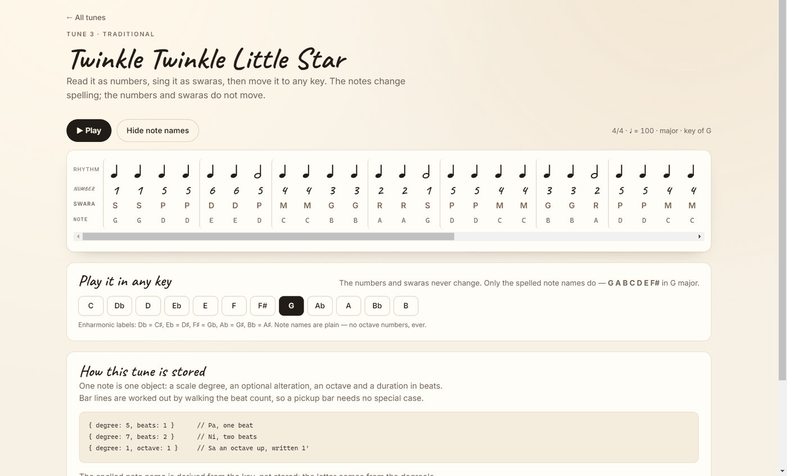
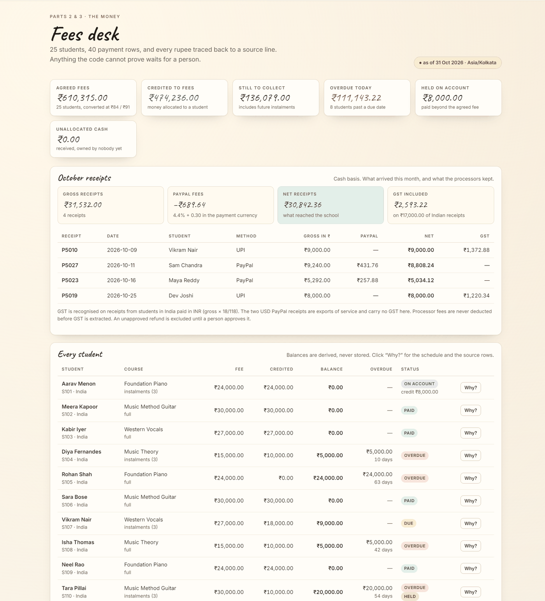

# Nathaniel School of Music — Founding Engineer work pack

Two working builds, one shared money engine, one automation skill, and a researched
plan for a Mac app. Built for the Nathaniel School of Music founding-engineer
assignment (November 2026).

**Motto of the sprint: idea in the morning, live by night.**

---

## What is in here

| Part | What it is | Where |
| --- | --- | --- |
| 1 | **Dhun, rebuilt**: tune shelf, tune pages, piano playback, twelve keys | `/dhun`, `src/lib/music/` |
| 2 | **Fees portal**: CSV import, SQLite, balances, overdue, October receipts, GST, review queue, reminder drafts | `/fees`, `src/lib/finance/` |
| 3 | **A working skill**: `daily-fees-reminders` (Track D) | `skills/daily-fees-reminders/` |
| 4 | **Shruti**: architecture, flow diagram, distribution and pricing plan | `docs/mac-app/` |

Everything is one Next.js application plus one Node CLI. There is exactly one
implementation of the money rules, and the portal and the skill both call it.

## What it looks like

Both images are the live deployment, not a mockup.

**Dhun, rebuilt** — `/dhun/twinkle` in the default key of G. Numbers and swaras hold
their place in every cell, note names are derived from the key (`F♯` in G, never
`Gb`), and no note name carries an octave digit.



**The fees desk** — `/fees`, reading Postgres. Six headline figures, the October
receipts with PayPal fees and GST separated, and the derived balances for all 25
students.



## Quick start

```bash
npm install
npm run db:import      # imports data/source/*.csv into data/fees.db
npm run dev            # http://localhost:3000
```

Then open:

- `http://localhost:3000/dhun` — the shelf
- `http://localhost:3000/dhun/twinkle` — a tune, playable in twelve keys
- `http://localhost:3000/fees` — the fees desk
- `http://localhost:3000/fees/students/S104` — "why is this number what it is?"

Requirements: Node 22.5+ (the app uses the built-in `node:sqlite` module, so there
is no native build step). Developed and tested on Node 24.

## Checks

```bash
npm test           # 74 tests
npm run typecheck  # tsc --noEmit
npm run build      # production build
npm run verify     # recomputes the real numbers and asserts them
```

`npm run verify` prints the headline figures straight from the source CSVs and
fails if any of them move. It exists so a reviewer does not have to trust this
README.

## Live links

**Live:** <https://nathaniel-workpack.vercel.app>

- `/dhun` — the tune shelf
- `/dhun/twinkle`, `/dhun/ode-to-joy`, `/dhun/happy-birthday` — the three tunes
- `/fees` — the fees desk, with one caveat below

**The fees backend is live on Postgres.** Vercel's filesystem is ephemeral and
read-only, so a SQLite file cannot hold the ledger there. The storage interface
now has two implementations — `src/lib/db/sqlite.ts` for local work and
`src/lib/db/postgres.ts` for deployment — chosen automatically by whether
`DATABASE_URL` is set. No finance code knows which one it is talking to.

Deployment uses a free-plan **Neon Postgres** database, created through the
Vercel Neon integration and connected to the project's production environment, so
`DATABASE_URL` is injected at runtime:

```bash
npm run db:import:pg     # reads DATABASE_URL, imports the two CSVs, idempotent
```

The import is keyed on the SHA-256 of the CSV pair, so a second run writes nothing.
If `DATABASE_URL` is missing or unreachable, `/fees` renders an honest "database
not connected" notice instead of failing with a 500.

Locally nothing changes: with no `DATABASE_URL`, the app uses `data/fees.db`.

**Source:** <https://github.com/nishant233032024/nathaniel-workpack> — public,
with the full history of how it was built. The code is **MIT licensed** (see
[`LICENSE`](LICENSE)); the two supplied CSVs remain the assignment's own exercise
data, and the three melodies are public domain.

## Part 1 — Dhun

Three tunes from Dhun's shelf — Twinkle Twinkle Little Star (4/4), Ode to Joy
(4/4) and Happy Birthday (3/4, with a pickup bar) — stored as data.

```ts
{ degree: 5, beats: 1 }              // Pa, one beat
{ degree: 7, beats: 2 }              // Ni, two beats
{ degree: 1, octave: 1, beats: 1 }   // Sa an octave up, written 1'
```

**Adding a fourth tune is one object in `src/lib/music/tunes.ts`.** No renderer,
route or playback change. There is a test that adds one.

The design decisions worth defending:

- **Note names are derived, not stored.** The letter comes from the degree's
  position in the scale; the accidental is whatever reaches the right pitch. In G
  major, degree 7 sits on the F line, so it is **F♯** — never Gb. This works in
  all twelve keys from one function, `spellDegree`.
- **Numbers and swaras never change with the key.** A test transposes every tune
  through all twelve keys and asserts the number/swara sequence is identical.
- **Bar lines are computed** by walking the beat count, which is why the pickup
  in Happy Birthday needs no special case in the renderer.
- **No octave digits in note names.** Octaves live in the number (`5'`, `,5`).
  A test rejects any rendered name containing a digit.
- **Audio is a small additive piano synthesiser**, not a sample library, so there
  is nothing to license and nothing to copy. Playback stops on stop, on a key
  change, on unmount and when the tab is hidden, and starting a new playback
  cancels the previous one.

## Part 2 — the fees desk

25 students, 40 payment rows, as of **31 October 2026, Asia/Kolkata** (fixed for
the exercise; not today's date).

### Why the numbers can be trusted

- **Every amount is an integer in minor units.** No float arithmetic touches a
  balance.
- **The database stores inputs and decisions only** — students, payments,
  resolutions, import batches, audit log. Balances are derived on every read. A
  re-import therefore cannot compound a financial effect; there is no running
  total to double.
- **Re-import is keyed on the SHA-256 of the two files.** Importing the same pair
  again is a no-op that says so.
- **Every figure links back to a source row.** `/fees/students/S104` shows the
  schedule, the payments, and the source line number of each one.

### The problems actually found in the export

More than the six the brief promises. Each one is handled explicitly, and each
has a test.

| # | Where | What is wrong | What the portal does |
| --- | --- | --- | --- |
| 1 | `P5007` / `P5036` | Same payer, date, amount and reference `UPI961168` on two rows | Counts cash once; `P5036` is marked duplicate. Counting it twice would make Diya look paid when she is ₹5,000 short. |
| 2 | `P5016` | "Tara P." with `tarap.music@example.com` — a partial name and an email that matches nobody | Not matched. Offered as a **weak** hint against Tara Pillai; her reminder is held. |
| 3 | `P5016` | Method says UPI, reference looks like a PayPal reference (`PAY190122`) | Left in review; method/reference disagreement is evidence, not decoration. |
| 4 | `P5038` | Aarav's fourth ₹8,000 payment on a ₹24,000 fee | Kept as **credit on account** (₹8,000), not revenue. |
| 5 | `P5038` | Note says "no name on payment" but the row has a payer name | Treated as a contradictory note, not as evidence of identity. |
| 6 | `P5039` | Ravi Kumar (billed in EUR) pays ₹5,000 cash | Currency mismatch → review. Not silently converted. |
| 7 | `P5040` | Omar Sethi (billed in USD) pays ₹330 by PayPal | Currency mismatch → review. |
| 8 | `P5037` | Nina Khan, −₹15,000, "refund: moved to a later batch" | Refunds are never inferred. Stays out of cash and credit until approved. |
| 9 | `P5011` | Vikram's payment is dated 8 Nov 2026, after the as-of date | Excluded from October receipts and from today's balance. |
| 10 | `P5012` | Isha Thomas paid ₹10,000 of a ₹15,000 full plan | Genuine partial; ₹5,000 overdue by 42 days. |
| 11 | `P5030` | €350 ÷ 3 instalments, paid as €117 | Schedule is 116.67 / 116.67 / 116.66; the extra 33 cents becomes credit toward the next instalment. |
| 12 | `P5022` / `P5023` | $190 ÷ 3 paid as $63 twice | Leaves a genuine **$0.67** residual — surfaced honestly rather than rounded away. |
| 13 | all | Instalments that do not divide evenly | Remainder is given one minor unit at a time to the earliest instalments; the parts always add back to the fee. |

### October receipts (computed from the CSVs)

| Line | Amount |
| --- | --- |
| Gross receipts | **₹31,532.00** |
| PayPal fees | **₹689.64** |
| Net receipts | **₹30,842.36** |
| GST included | **₹2,593.22** (on ₹17,000.00 of Indian receipts) |

The four October receipts are Vikram ₹9,000 (UPI), Dev ₹8,000 (UPI), Sam $110
(PayPal) and Maya $63 (PayPal). GST applies to the two Indian UPI receipts
(₹9,000 and ₹8,000, gross × 18/118). The two USD receipts are exports of service
and carry no GST here. Processor fees are **not** deducted before GST is
extracted.

### The rules, and where they are configurable

All in `src/lib/finance/config.ts` and explained in
[`docs/decisions/0001-finance-rules.md`](docs/decisions/0001-finance-rules.md):
exchange rates (84 / 91), PayPal (4.4% + 0.30 in the payment currency), GST
(18% inclusive), the first instalment anchor, the 30-day interval, and whether
something due today counts as overdue (it does not, by default).

### Human workflow

The review queue shows, for each uncertain row: the source line, the reason, the
candidate matches and how strong the evidence is, what happens to **cash** and
what happens to **student credit**, the permitted corrections, the status, and
the audit trail. The actions implemented are only the ones the real data needs:
assign to a student (with an explicit cross-currency confirmation), treat as real
cash with no student, approve a refund, hold, and undo.

### Reminder drafts

One per overdue student, in the student's own currency, quoting only the overdue
amount, never a future instalment, with no invented links. Reminders are **held**
when an unresolved payment could change that student's balance.

## Part 3 — the skill

`skills/daily-fees-reminders/` — Track D. Same engine as the portal, a
deterministic CLI, four output files.

```bash
npx tsx skills/daily-fees-reminders/run.ts \
  --students data/source/students.csv \
  --payments data/source/payments.csv \
  --as-of 2026-10-31
```

It writes `reminders.csv`, `admin-summary.txt`, `review-report.json` and
`run-manifest.json`. Two consecutive runs produced byte-identical
`reminders.csv` and `admin-summary.txt` (verified by hash). The manifest carries
the only timestamp, because operational metadata must not change financial
output. Nothing is ever sent. `SKILL.md` defines the contract an agent follows,
including what it is forbidden to infer.

## Part 4 — Shruti

Per-app audio control for macOS. Researched architecture, not a native
implementation.

- [`docs/mac-app/shruti-architecture.md`](docs/mac-app/shruti-architecture.md) — flow, frameworks, permissions, failure modes, risk register, distribution, pricing, launch
- [`docs/mac-app/shruti-flow.drawio`](docs/mac-app/shruti-flow.drawio) — editable diagram
- [`docs/mac-app/shruti-flow.svg`](docs/mac-app/shruti-flow.svg) — viewable export

The load-bearing fact: **`AudioHardwareCreateProcessTap` is macOS 14.2+**, and a
tap can mute the original process output. That is what removes both the virtual
driver and the doubled audio — but only if the app renders the audio itself
instead of letting the source app keep playing.

## Honest limitations

- The site is deployed to Vercel and the code is public on GitHub.
- The deployed fees desk runs on Neon's free plan, which suspends idle compute;
  the first request after a quiet period may take an extra second while it wakes.
  SQLite remains the local backend.
- The piano is synthesised; it is recognisably a piano, but it is not a sampled
  grand.
- There is no phone number column in the export, so reminders are drafts with no
  recipient attached.
- The portal has no authentication: it is an admin tool meant to run locally or
  behind a login. It must not be published with real student data.
- Shruti is a design, not an app.
- Part 3 is not scheduled anywhere. `SKILL.md` documents the cron/launchd shape
  and says plainly that no scheduler is deployed.

## AI use

Built with an AI coding agent, working to rules I set. The mistakes it made and
the corrections are recorded in [`docs/ai-use.md`](docs/ai-use.md) — including
three bugs the tests caught. Read that before the video: you should be able to
explain every one of them.
